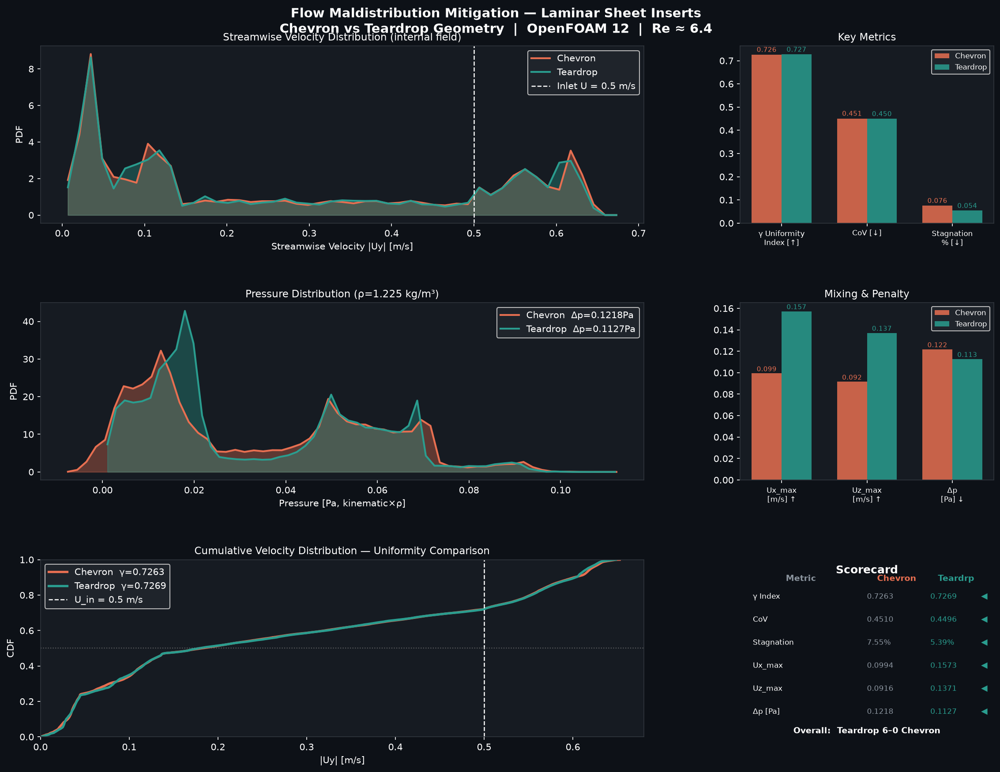

# OpenFOAM CFD — Laminar Flow Maldistribution Mitigation
### Chevron vs Teardrop Sheet Insert Geometries

A comparative CFD study using **OpenFOAM 12** (`foamRun / incompressibleFluid`) to evaluate two sheet insert geometries — **chevron** and **teardrop** — for mitigating flow maldistribution in a laminar channel flow.

---

## Problem Statement

Flow maldistribution (non-uniform velocity across a cross-section) reduces the effectiveness of heat exchangers, reactors, and filtration systems. This study evaluates surface-mounted protrusions on a thin sheet as passive flow distributors.

---

## Cases

| Case | Insert Geometry | Description |
|---|---|---|
| `laminar_sheet_chevron` | Triangular chevron | Sharp apex pointing upstream, 120 mm wide × 200 mm long × 10 mm tall |
| `laminar_sheet_teardrop` | Biconvex teardrop | Streamlined lens shape (intersection of 2 circles r=145 mm), 10 mm tall |

Both cases share identical flow conditions:
- **Channel**: 200 mm wide × 1200 mm long computational domain, height 97 mm
- **Fluid**: Air, ν = 1.563 × 10⁻⁵ m²/s
- **Inlet**: Uniform U = 0.5 m/s
- **Re ≈ 3,103** based on the 97 mm channel height: Re = U H / ν. The calculation uses a laminar model; this Reynolds number alone does not establish that the physical flow is laminar.
- **Mesh**: ~142,000 cells (snappyHexMesh, surface refinement level 2)
- **End time**: 10 s

---

## Key Results

| Metric | Chevron | Teardrop | Winner |
|---|---|---|---|
| Velocity Uniformity Index (γ) | 0.7263 | **0.7269** | Teardrop |
| Coefficient of Variation (CoV) | 0.4510 | **0.4496** | Teardrop |
| Stagnation fraction | 7.55% | **5.39%** | Teardrop −29% |
| Max lateral spread (Ux) | 0.099 m/s | **0.157 m/s** | Teardrop +58% |
| Max vertical mixing (Uz) | 0.092 m/s | **0.137 m/s** | Teardrop +50% |
| Pressure drop | 0.122 Pa | **0.113 Pa** | Teardrop −7.4% |

These are preliminary single-mesh, laminar-model results. The uniformity-index difference is only 0.0006; its significance and the ranking of the geometries are unknown until mesh and time-step sensitivity have been assessed. Velocity maxima do not by themselves establish mixing, and the pressure figures in the table are field extrema rather than inlet-to-outlet pressure drops.

---

## Mesh independence: not yet established

Only one mesh per geometry is reported. For each geometry, run at least three systematically refined meshes, keeping geometry, boundary conditions, physical model, sampling locations and solver tolerances consistent. Record cell count, mesh-quality checks, residuals and mass imbalance; compare the same volume- or area-weighted uniformity metric, stagnation measure, and inlet-to-outlet pressure drop at a matched converged time. Refine both the background mesh and the insert/wall resolution, and check time-step sensitivity separately. Report successive changes and, where appropriate, an uncertainty estimate such as GCI. Repeat the comparison with a suitable transitional or turbulent model and validation data before drawing conclusions about physical flow.

No additional meshes have been run or verified for this update. A small change between two results alone does not prove convergence, especially for the 0.0006 difference in γ.

---

## Comparative Plot



---

## Full Postprocessing Report

See [`cfd_maldistribution_report.md`](cfd_maldistribution_report.md) for detailed analysis including velocity distributions, pressure field stats, physical interpretation, and design recommendations.

---

## Geometry Files

The insert geometries are defined in OpenSCAD:
- [`laminar_sheet_chevron/sheet_chevron.scad`](laminar_sheet_chevron/sheet_chevron.scad)
- [`laminar_sheet_teardrop/teardrop.scad`](laminar_sheet_teardrop/teardrop.scad)

---

## Repository Structure

```
├── laminar_sheet_chevron/       # Chevron insert case
│   ├── 0/                       # Initial conditions (U, p, T)
│   ├── constant/                # Physical properties, mesh
│   ├── system/                  # controlDict, fvSchemes, fvSolution, snappyHexMeshDict
│   └── sheet_chevron.scad       # Insert geometry (OpenSCAD)
├── laminar_sheet_teardrop/      # Teardrop insert case
│   ├── 0/                       # Initial conditions (U, p, T)
│   ├── constant/                # Physical properties, mesh
│   ├── system/                  # controlDict, fvSchemes, fvSolution, snappyHexMeshDict
│   └── teardrop.scad            # Insert geometry (OpenSCAD)
├── cfd_maldistribution_report.md   # Detailed postprocessing report
├── cfd_maldistribution_analysis.png # Comparative plots
└── README.md
```

> **Note**: Time-step field data (U, p, phi) and zip archives are excluded via `.gitignore` due to file size.

---

## Software
- [OpenFOAM 12](https://openfoam.org/)
- [OpenSCAD](https://openscad.org/) (geometry generation)

## Author
goatnath — 2026

